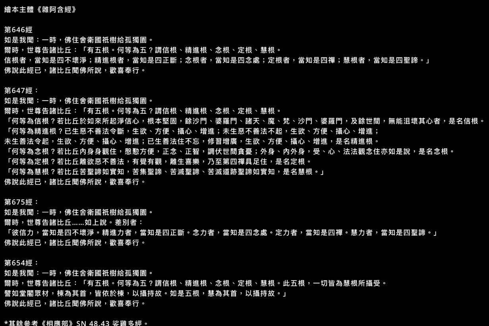

片長 06:50.73。時間依成片上緣字幕取樣，約至秒。逐段文字依可見字幕與創作口白整理，未逐字聽校音軌。圖上百分比以全幅左上角為原點，位置取自影片的近似值。口白及下緣經文在繪本圖外隨段顯示。

<table-of-contents />

## S01｜中央島與兩道水流（00:00–01:02）

### 完整口白與時間

<b>00:00–00:07</b>　在佛法中，有五種很重要的修行能力:信、精進、念、定、慧。

<b>00:07–00:15</b>　可是，同樣這五種能力，佛陀有時稱它們為「五根」，有時又稱它們為「五力」。

<b>00:15–00:19</b>　明明內容一樣，為什麼要說成兩種名字呢？

<b>00:19–00:23</b>　佛陀曾用一個很生動的譬喻來說明。

<b>00:23–00:28</b>　就像一條大河，水向前流去，中間有一座島嶼。

<b>00:28–00:32</b>　因為這座島，河水分從兩側流過。

<b>00:32–00:36</b>　從一個角度看，這像是兩道水流；

<b>00:36–00:40</b>　但從另一個角度看，它其實仍是同一條河。

<b>00:40–00:43</b>　五根與五力，也是這樣。

<b>00:43–00:49</b>　信、精進、念、定、慧，本來就是同樣五種修行能力。

<b>00:49–00:55</b>　從一個角度來說，稱為五根；從另一個角度來說，稱為五力。

<b>00:55–01:02</b>　所以，佛陀不是在說十種不同的法，而是在說同樣五法的不同觀點。

### 原經文對應

經文
48相應43經(SN 48.43),又被稱作《娑雞多經》(Sāketasutta)

「比丘們!什麼法門,由此法門該河算作一條水流呢?比丘們!沙洲之前的水流與沙洲之後的水流。比丘們!這是法門,由此法門該河算作一條水流。
「比丘們!什麼法門,由此法門該河算作二條水流呢?比丘們!沙洲北邊的水流與沙洲南邊的水流。比丘們!這是法門,由此法門該河算作二條水流。
「比丘們!同樣地,信根者,可謂信力;信力者,可謂信根。精進根者,可謂精進力;精進力者,可謂精進根。念根者,可謂念力;念力者,可謂念根。定根者,可謂定力;定力者,可謂定根。慧根者,可謂慧力;慧力者,可謂慧根。

### 網頁疊字

晴天無牌版，全幅。

## S02｜根與力的作用（01:02–01:42）

### 完整口白與時間

<b>01:02–01:08</b>　既然是同樣的五種能力，為什麼又要分成「根」與「力」呢？

<b>01:08–01:13</b>　佛陀在這部經中，並沒有說五根修到後來，才變成五力。

<b>01:13–01:20</b>　而是說，信根就是信力，精進、念、定、慧，也是如此。

<b>01:20–01:28</b>　如果從修行的作用來理解，「根」著重的是它能在心中建立、主導修行；

<b>01:28–01:34</b>　「力」則著重的是它已具有力量，面對相反的障礙時，不容易被動搖。

<b>01:34–01:42</b>　就像同一棵樹，向下有根，讓它站穩；向上有力量，讓它經得起風吹雨打。

### 原經文對應

SN 48.43 引文見第一幕。樹根站穩與抗風是影片的教學譬喻。

### 網頁疊字

大樹與根系，全幅。

## S03｜五根地圖（01:42–02:15）

### 完整口白與時間

<b>01:42–01:47</b>　那麼，佛陀所說的五根，內容到底是什麼呢？

<b>01:47–01:53</b>　在經中，五根分別是:信根、精進根、念根、定根、慧根。

<b>01:53–01:56</b>　信根，依於四不壞淨；

<b>01:56–01:59</b>　精進根，依於四正斷(四正勤)；

<b>01:59–02:02</b>　念根，依於四念處；

<b>02:02–02:04</b>　定根，依於四禪；

<b>02:04–02:07</b>　慧根，依於四聖諦。

<b>02:07–02:10</b>　也就是說，五根並不是抽象的名稱，

<b>02:10–02:15</b>　而是把修行中幾個重要法門，統整成五種關鍵的能力。

### 原經文對應

646經

有五根。何等為五?謂信根、精進根、念根、定根、慧根。信根者,當知是四不壞淨;精進根者,當知是四正斷;念根者,當知是四念處;定根者,當知是四禪;慧根者,當知是四聖諦。

### 網頁疊字

五塊牌字已嵌入原圖，依口白依次指讀。

## S04｜信根（02:15–02:50）

### 完整口白與時間

<b>02:15–02:24</b>　先從第一個「信根」來看。《雜阿含經》第646經說:信根，就是四不壞淨。

<b>02:24–02:30</b>　也就是對佛、法、僧、戒，建立堅固清淨的信心。

<b>02:30–02:36</b>　第647經又進一步說，對如來生起淨信，「根本堅固」，

<b>02:36–02:41</b>　即使受到外界不同的說法影響，也不能輕易動搖這顆心。

<b>02:41–02:46</b>　所以「信根」的信，不只是「我相信」而已，

<b>02:46–02:50</b>　而是修行的方向，已經慢慢在心中扎下了根。

### 原經文對應

646經

信根者,當知是四不壞淨;

647經

若比丘於如來所起淨信心,根本堅固,餘沙門、婆羅門、諸天、魔、
梵、沙門、婆羅門,及餘世間,無能沮壞其心者,是名信根。

### 網頁疊字

黑字「信」約 x=60%、y=46%。

## S05｜精進根（02:50–03:30）

### 完整口白與時間

<b>02:50–02:54</b>　接著來看第二個，精進根。

<b>02:54–03:00</b>　《雜阿含經》第646經說，精進根，依於四正斷(四正勤)。

<b>03:00–03:07</b>　還沒生起的不善法，要防止它生起；已經生起的不善法，要努力斷除；

<b>03:07–03:15</b>　還沒生起的善法，要讓它生起；已經生起的善法，要令它安住增長。

<b>03:15–03:22</b>　所以，精進不是盲目地用力，而是懂得在心中除草，也懂得護苗。

<b>03:22–03:27</b>　該放下的，要放下；該培養的，要好好培養。

<b>03:27–03:30</b>　這樣的努力，就叫做精進根。

### 原經文對應

646經

精進根者,當知是四正斷;

647經

已生惡不善法令斷,生欲、方便、攝心、增進;未生惡不善法不起,生欲、方便、攝心、增進;未生善法令起,生欲、方便、攝心、增進;已生善法住不忘,修習增廣,生欲、方便、攝心、增進,是名精進根。

### 網頁疊字

黑字「精進」約 x=73%、y=11%。

## S06｜念根（03:30–04:18）

### 完整口白與時間

<b>03:30–03:38</b>　第三個，是念根。《雜阿含經》第646經說，念根，就是四念處。

<b>03:38–03:43</b>　第647經進一步說，對身、受、心、法，

<b>03:43–03:48</b>　保持正念、正知，觀察它們當下真實的狀態。

<b>03:48–03:52</b>　也就是說，身體正在發生什麼，

<b>03:52–03:56</b>　現在感受到的是樂、苦，還是不苦不樂，

<b>03:56–04:02</b>　心中是平靜、煩躁，還是貪著，都能清楚地知道。

<b>04:02–04:09</b>　就像一座觀測站，天氣可以不斷變化，我們不需要命令天空一定要晴朗，

<b>04:09–04:18</b>　只是清楚知道，此刻，正在發生什麼。這樣持續而清楚的覺察，就是念根。

### 原經文對應

646經

念根者,當知是四念處;

647經

若比丘內身身觀住,慇懃方便,正念、正智,調伏世間貪憂;外身、內外身,受、心、法法觀念住亦如是說,是名念根。

### 網頁疊字

黑字「念」約 x=77%、y=11%。

## S07｜定根（04:18–05:01）

### 完整口白與時間

<b>04:18–04:26</b>　第四個，是定根。《雜阿含經》第646經說，定根，就是四禪。

<b>04:26–04:33</b>　當心不再一直追逐外境，也不再被各種念頭拉著跑，便能逐漸收攝、安住。

<b>04:33–04:39</b>　就像原本還有波紋的水面，慢慢平靜下來，最後清澈而穩定。

<b>04:39–04:44</b>　前面的「念」，是清楚知道身心正在發生什麼；

<b>04:44–04:50</b>　而「定」，則是讓這顆心不再四處散亂，能夠穩穩地安住。

<b>04:50–04:57</b>　佛陀以初禪、第二禪、第三禪、第四禪，來說明定根的修習。

<b>04:57–05:01</b>　這種安定、收攝而不散亂的能力，就是定根。

### 原經文對應

646經

定根者,當知是四禪;

647經

若比丘離欲惡不善法,有覺有觀,離生喜樂,乃至第四禪具足住,是名定根。

### 網頁疊字

黑字「定」約 x=77%、y=11%。

## S08｜慧根（05:01–05:55）

### 完整口白與時間

<b>05:01–05:10</b>　最後，是慧根。《雜阿含經》第646經說，慧根，就是對四聖諦的修習。

<b>05:10–05:15</b>　也就是如實了解:什麼是苦，苦從何而生，苦能不能止息，

<b>05:15–05:20</b>　以及，要走什麼樣的道路，才能走向苦的止息。

<b>05:20–05:27</b>　就像小貓走上高處，原本身在山谷裡時，只能看見眼前的一小段路。

<b>05:27–05:30</b>　現在，視野打開了。

<b>05:30–05:37</b>　哪裡是崎嶇的山谷，水流從哪裡匯聚而來，遠方哪裡是平靜的出口，

<b>05:37–05:41</b>　又有哪一條道路可以走到那裡，都逐漸看得清楚。

<b>05:41–05:44</b>　所以，慧不是知道很多知識，

<b>05:44–05:49</b>　而是對苦、苦的原因、苦的止息，以及通往止息的道路，

<b>05:49–05:55</b>　有如實而清楚的了解。這樣的能力，就是慧根。

### 原經文對應

646經

慧根者,當知是四聖諦。

647經

若比丘苦聖諦如實知,苦集聖諦、苦滅聖諦、苦滅道跡聖諦如實知,是名慧根。

### 網頁疊字

黑字「慧」約 x=64%、y=11%。

## S09｜五力（05:55–06:22）

### 完整口白與時間

<b>05:55–06:02</b>　那麼，五力又是什麼呢？其實，五力並不是另外五種修行。

<b>06:02–06:08</b>　仍然是信、精進、念、定、慧。只是當我們從它們面對障礙，

<b>06:08–06:13</b>　仍然不容易被動搖的這一面來看，就稱為「五力」。

<b>06:13–06:17</b>　就像這座島，風雨來了，依然站得住。

<b>06:17–06:22</b>　五根與五力，就是同樣五種能力的不同面向。

### 原經文對應

675經

彼信力,當知是四不壞淨。精進力者,當知是四正斷。念力者,當知是四念處。定力者,當知是四禪。慧力者,當知是四聖諦。

48相應43經(SN 48.43),又被稱作《娑雞多經》(Sāketasutta)

「比丘們!什麼法門,由此法門該河算作一條水流呢?比丘們!沙洲之前的水流與沙洲之後的水流。比丘們!這是法門,由此法門該河算作一條水流。
「比丘們!什麼法門,由此法門該河算作二條水流呢?比丘們!沙洲北邊的水流與沙洲南邊的水流。比丘們!這是法門,由此法門該河算作二條水流。
「比丘們!同樣地,信根者,可謂信力;信力者,可謂信根。精進根者,可謂精進力;精進力者,可謂精進根。念根者,可謂念力;念力者,可謂念根。定根者,可謂定力;定力者,可謂定根。慧根者,可謂慧力;慧力者,可謂慧根。

### 網頁疊字

風雨版中央島，全幅。

## S10｜慧為其首（06:22–06:49）

### 完整口白與時間

<b>06:22–06:30</b>　最後，佛陀又用一個譬喻來說明五根的關係。《雜阿含經》第654經說:

<b>06:30–06:36</b>　五根之中，慧根就像一座房屋的棟樑，其他材料都依靠它來攝持。

<b>06:36–06:44</b>　這並不是說其他四根不重要。信、精進、念、定，都不可缺少；

<b>06:44–06:49</b>　而慧，讓這些修行有了正確的方向，共同走向覺悟。

### 原經文對應

654經

此五根,一切皆為慧根所攝受。譬如堂閣眾材,棟為其首,皆依於棟,
以攝持故。如是五根,慧為其首,以攝持故。

### 網頁疊字

木屋棟樑，全幅。

## 06:49–06:50.73｜片尾經文出處

