# 四向四果與十結｜逐幕分鏡

## S01 彼岸是什麼｜00:00–00:38

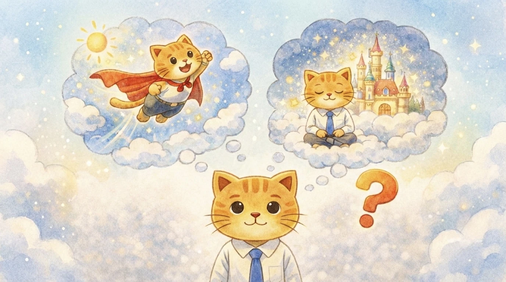

- 圖內疊字：空。
- 原圖與避讓：雲中超人、城堡、中央小貓及橘色問號。問號屬原圖；上緣文字避開兩朵雲與角色。
- 下緣經文：《雜阿含經》490：涅槃者，貪欲永盡、瞋恚永盡、愚癡永盡，一切諸煩惱永盡，是名涅槃。
- 上緣字幕（黑字、靠左）：

- 00:00 學習佛法的過程中，經常會聽到一個詞，叫做「度過生死河流，到達彼岸」。
- 00:08 很多讀者可能會好奇：「到底要修到什麼程度，才算是真正到了彼岸呢？
- 00:14 到了彼岸之後，是不是會飛天遁地，或者跑到某個神祕的仙境呢？」
- 00:20 其實，佛陀的智慧大弟子舍利弗，曾給過一個非常明確又踏實的答案。
- 00:28 他說：「所謂涅槃，也就是到彼岸，
- 00:32 就是貪欲永盡、瞋恚永盡、愚癡永盡，一切諸煩惱永盡。」

## S02 斷開十結｜00:38–01:26

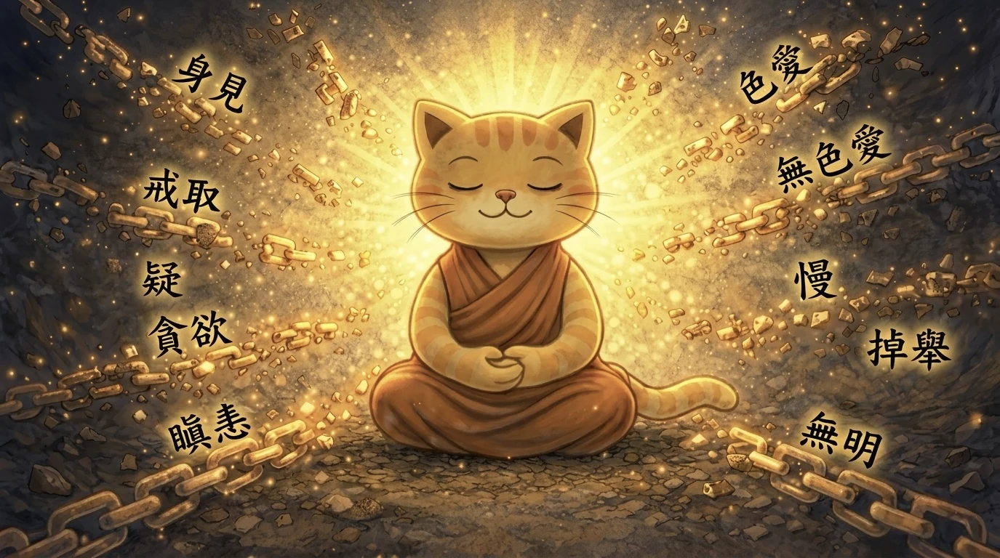

- 圖內疊字：空。
- 原圖與避讓：十個名稱是原圖自帶字。左側自上而下：身見、戒取、疑、貪欲、瞋恚。右側自上而下：色愛、無色愛、慢、掉舉、無明。完整顯示兩側鎖鏈，不裁左右。字幕用「憍慢」，圖上的「慢」照留。
- 下緣經文：《長阿含經・眾集經》：有五法，謂五下結……復有五法，謂五上結……。引文列舉次序與畫上十結排列分開保留。
- 上緣字幕（白字、靠左）：

- 00:38 許多人以為，佛教的「涅槃」或「滅諦」，
- 00:42 是獲得某種神奇的超能力，或是飛昇到某個神祕的地方。
- 00:48 但其實，解脫的重點不在於「獲得」什麼，反而是「捨去」什麼。
- 00:54 這是一場徹頭徹尾的「減法淨化工程」。
- 00:58 真正的解脫，就是精確且不可逆轉地，
- 01:02 切斷將我們綁在生死輪迴中的十條心理鎖鏈。這在佛法中，被稱為「十結」。
- 01:10 它們包含了將我們綁在欲界的「五下分結」：身見、戒取、疑、貪欲、瞋恚；
- 01:18 以及潛藏在更深層意識中的五上分結：色愛、無色愛、憍慢、掉舉、無明。

## S03 四種姓｜01:26–01:44

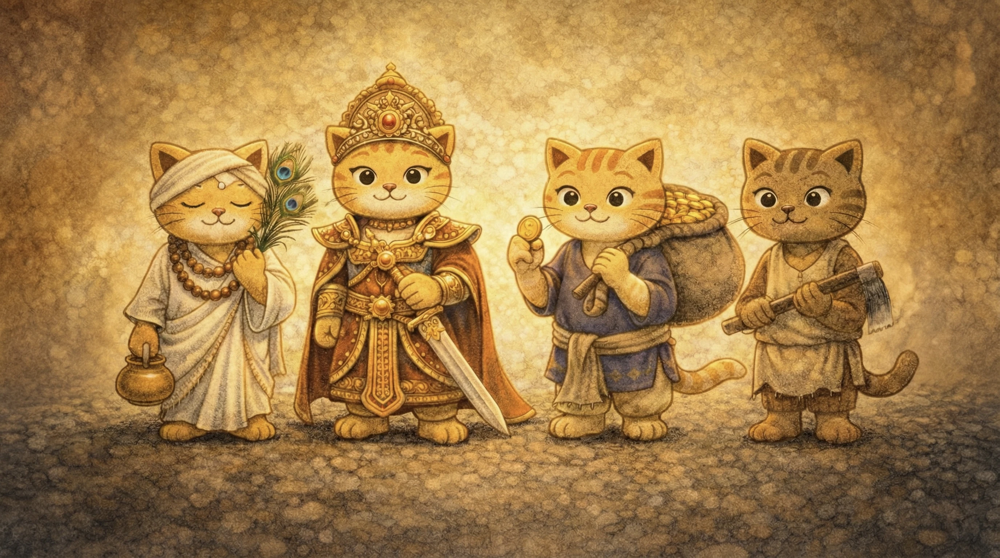

- 圖內疊字：空。
- 原圖與避讓：四貓由左至右分別為白袍持羽、王冠持劍、背錢袋、持工具。影片沒有逐一貼名牌，也沒有把四個角色分配給四果。
- 下緣經文：《長阿含經・初小緣經》：諸婆羅門種、居士、首陀羅種亦應如是篤信於佛、信法、信眾，成就聖戒。
- 上緣字幕（白字、靠左）：

- 01:26 這條切斷鎖鏈的道路，對所有人都是敞開的。
- 01:30 在《長阿含經·初小緣經》中，佛陀打破了當時社會的種姓階級神話。
- 01:36 他宣告：不論是出身於高貴的剎帝利、婆羅門，還是平民的居士、首陀羅；

## S04 同一條修行路｜01:44–02:06

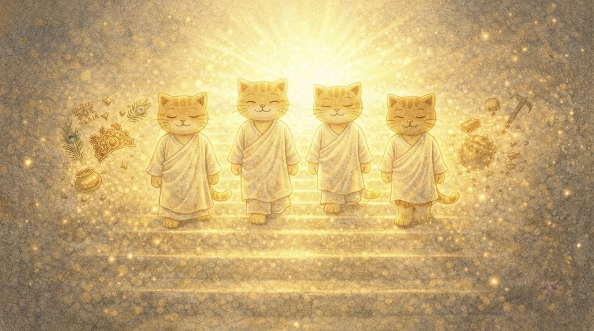

- 圖內疊字：空。
- 原圖與避讓：金光下四隻同樣衣著的小貓。亮區需補字幕對比。避免在角色頭上添加果位名。
- 下緣經文：《長阿含經・初小緣經》：諸婆羅門種、居士、首陀羅種亦應如是篤信於佛、信法、信眾，成就聖戒。
- 上緣字幕（白字、靠左）：

- 01:44 只要能篤信佛、法、僧三寶，成就聖戒，
- 01:50 都能平等地進入「四向四果」的修行階位。
- 01:54 這不僅是客觀衡量修證境界的標準，更是佛教眾生平等理念的最具體實踐。
- 02:02 因為真正的尊貴，來自於內心的淨化，而非外在的血統。

## S05 凡夫繞柱｜02:06–02:22

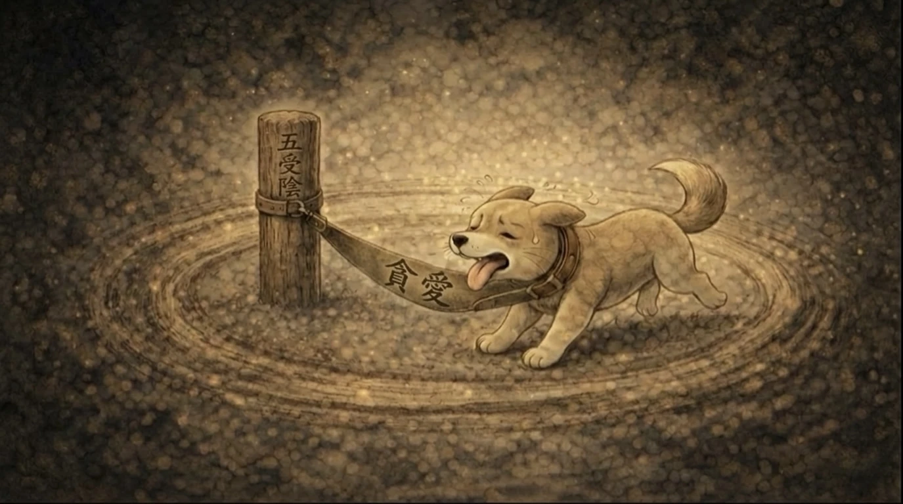

- 圖內疊字：空。
- 原圖與避讓：柱上直排「五受陰」，皮帶上斜排「貪愛」，都已在原圖。IMG_0346.jpg 把「五受陰」印在皮帶、柱上無字，列為備用對照。
- 下緣經文：《雜阿含經》266：繫狗子著柱而繞柱轉的譬喻，接不如實知色、受、想、行、識而隨轉。完整影片字句待校。
- 上緣字幕（白字、靠左）：

- 02:06 凡夫就像一隻狗，被名為「貪愛」的皮帶，
- 02:12 緊緊拴在代表我們身心的「五受陰」這根柱子上。
- 02:16 無論怎麼用力奔跑，都只能盲目地繞著圈圈，不斷在生死之流中輪迴。

## S06 初果須陀洹｜02:22–03:10

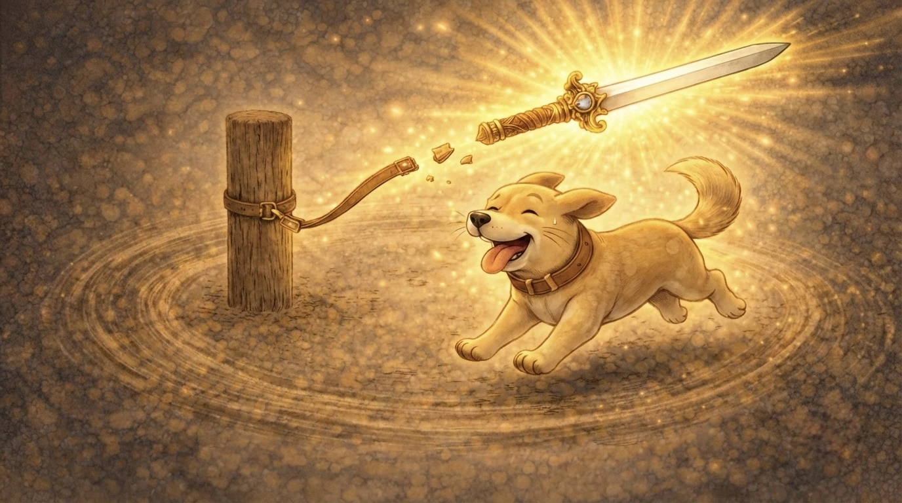

- 圖內疊字：空。
- 原圖與避讓：智慧之劍斬斷繫帶，小狗離柱。正式編排採 IMG_0343.jpg，保留斷帶、金劍與小狗。避免把初果誤標成十結全斷。
- 下緣經文：《增壹阿含經》卷二十〈聲聞品〉：斷三結使，成須陀洹……極遲經七死七生……猶如黃藍之花朝取暮長。
- 上緣字幕（白字、靠左）：

- 02:22 解脫的第一關，稱為初果「須陀洹」。
- 02:26 修行人在這裡斷了前三個結：破除了以為有恆常自我的「身見」，
- 02:34 不再迷信盲目儀式的「戒禁取」，以及斷除了對真理的「疑」。
- 02:38 這就像那隻被拴在柱子上的狗，終於被智慧之劍切斷了皮帶，不再盲目打轉。
- 02:46 佛陀形容初果聖者就像是「黃藍花」，
- 02:50 即使在早晨被採摘，到了晚上依然能繼續生長發育。
- 02:56 這象徵著他們道心堅固，生生不息，已步入解脫之流，絕對不再墮入三惡道。
- 03:02 最多只需在天上與人間往返受生七次，就必定能抵達苦的盡頭，證得涅槃。

## S07 欲貪與瞋恚｜03:10–03:44

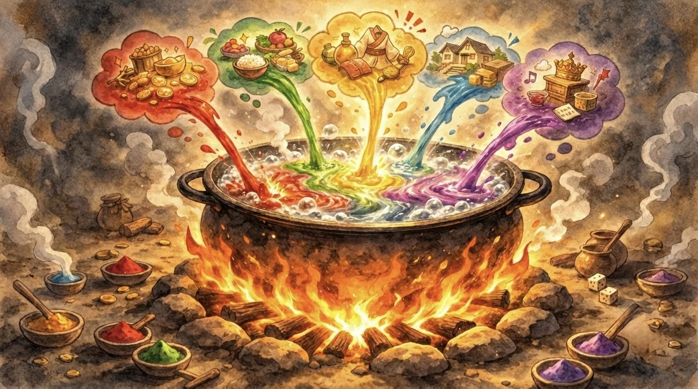

- 圖內疊字：空。
- 原圖與避讓：彩色欲望雲、鍋水、底火。約 03:30 上緣字幕從欲貪切到瞋恚，畫面仍用同一張，底部引文跟著切換。
- 下緣經文：《相應部》46.55：加染料的水譬欲貪。約 03:30 後切換為煮沸之水譬瞋恚。
- 上緣字幕（白字、靠左）：

- 03:10 凡夫的心，常常被兩股強大的力量干擾。
- 03:14 第一個是「欲貪」。它就像在純淨的水中，混入了鮮豔的染料。
- 03:20 貪愛雖然看起來色彩繽紛、充滿誘惑，
- 03:24 卻會讓內心失去清澈度，蒙蔽我們看清真相的雙眼。
- 03:30 第二個是「瞋恚」。它就像是在水盆底下猛烈燃燒的烈火。
- 03:36 當人發怒時，內心就像沸水一樣翻騰冒泡，根本無法平靜下來看清事實。

## S08 二果斯陀含｜03:44–04:26

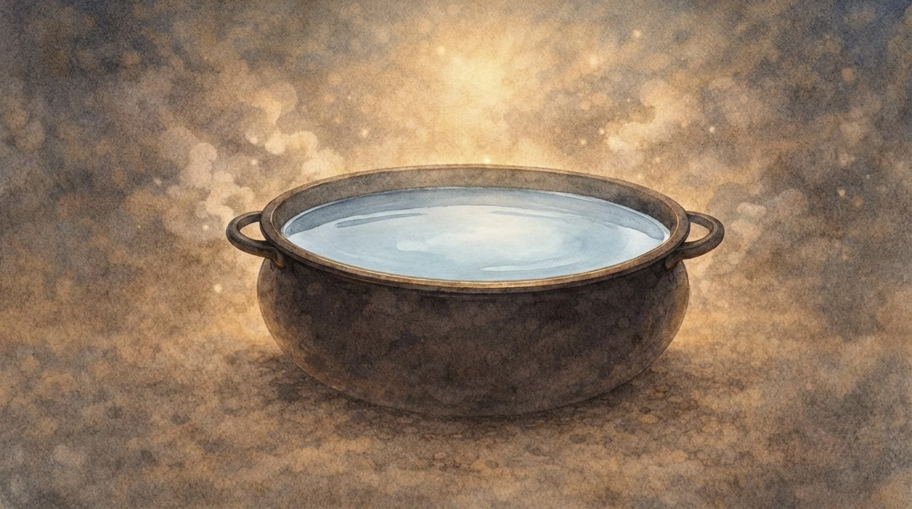

- 圖內疊字：空。
- 原圖與避讓：同構圖轉成平靜的水鍋，底火已撤，正式編排採 IMG_0345.jpg，保留鍋緣與水面。二果是貪、瞋、癡薄；三果段才轉為五下分結盡。
- 下緣經文：《增壹阿含經》卷二十〈聲聞品第二十八〉第七經（EA 28.7），T02, no. 125, p. 653c22–27：「猶如邠陀利花，晨朝剖花，向暮萎死」。[大正藏電子原文（SAT）](https://21dzk.l.u-tokyo.ac.jp/SAT/ddb-sat2.php?mode=detail&useid=0125_%2C02%2C0653)
- 上緣字幕（白字、靠左）：

- 03:44 解脫的第二關，是二果「斯陀含」。修行人除了斷除前三結，
- 03:50 更大幅消減了「欲貪」與「瞋恚」這兩股驅動力。
- 03:56 如果說凡夫的情緒像沸騰的濁水，那二果聖者就像是被抽去了底下的烈火。
- 04:02 即使偶爾還有情緒的微波，也只像是溫水，很快就會平靜冷卻。
- 04:10 佛陀以「邠陀利花」比喻二果聖者。花在清晨剖開，到傍晚便枯萎。
- 04:16 這象徵著他們在輪迴中受苦的時日已經極其短暫了，
- 04:20 最多只需在天上與人間往返受生一次，就能抵達解脫的終點。

## S09 三果阿那含｜04:26–05:14

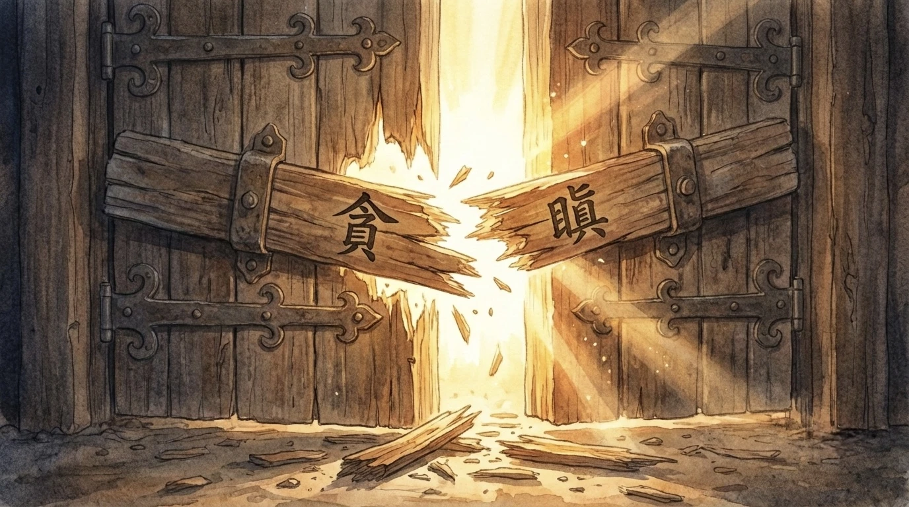

- 圖內疊字：空。
- 原圖與避讓：門閂左「貪」右「瞋」是原圖自帶字。中間門縫很亮，字幕需有局部襯底，不能遮住門閂上的字。底部經文約 04:52 切換。
- 下緣經文：《雜阿含經》71：云何斷關？謂斷五下分結。約 04:52 改《增壹阿含經》柔軟沙門段：斷五下分結，成阿那含，即於彼般涅槃，不來此世。
- 上緣字幕（白字、靠左）：

- 04:26 解脫的第三關，是三果「阿那含」。在這裡，修行人迎來了巨大的昇華。
- 04:34 他們徹底斷除了「欲貪」與「瞋恚」，
- 04:38 將把人綁在欲界的五條粗重鎖鏈「五下分結」全數斷盡。
- 04:44 佛陀形容這個境界叫做「斷關」，
- 04:48 就像是打破了將眾生關在欲界牢籠裡的那道門閂。
- 04:52 佛陀也稱呼他們為「柔軟沙門」。因為三果聖者的心性已徹底調柔，
- 05:00 永遠不再被欲界的粗重煩惱與情緒所激盪。
- 05:04 他們在此生結束後，將直接迎向清淨的高層天界，
- 05:10 永遠不會再回到這個充滿煩惱的世間。

## S10 四果阿羅漢｜05:14–06:00

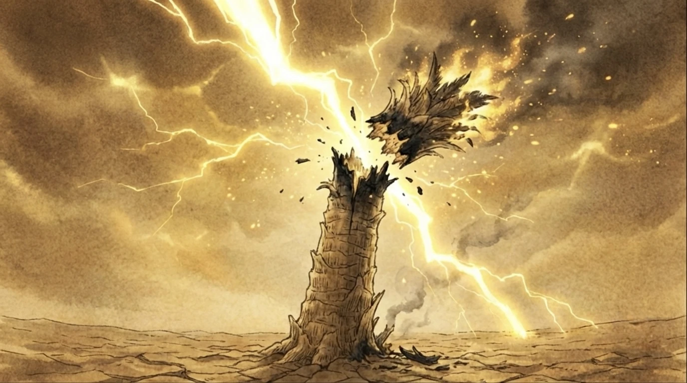

- 圖內疊字：空。
- 原圖與避讓：棕櫚樹冠被閃電截斷。保留中央閃電、樹冠與斷裂處，影片沒有另貼五上分結標籤。底部約 05:40 改 SA297，約 05:46 回四果節錄。
- 下緣經文：《增壹阿含經》柔軟中柔軟沙門段：有漏盡，成無漏心解脫、智慧解脫……。約 05:40 換《雜阿含經》297「斷其根本，如截多羅樹頭，於未來世成不生法」，約 05:46 回增壹阿含經。
- 上緣字幕（黑字、靠左）：

- 05:14 最後一關，是四果「阿羅漢」。
- 05:18 在這裡，修行人運用極細微的智慧，拔除了最後五條隱形的絲線「五上分結」，
- 05:26 包含對「色界」與「無色界」高深禪定的貪愛（色愛與無色愛），
- 05:30 微細的心靈動盪（掉舉）、潛在的自我優越感（慢），
- 05:34 以及最深層的盲點（無明）。十結全斷，這場解脫的減法工程終於完成。
- 05:40 就如同被閃電截斷了樹冠的棕櫚樹，煩惱永遠不再生長。
- 05:46 佛陀尊稱他們為柔軟中柔軟沙門。這代表他們的心智已徹底卸下所有重擔，
- 05:54 達到了最極致的清淨、無著與絕對的自由。

## S11 現世安隱｜06:00–07:08

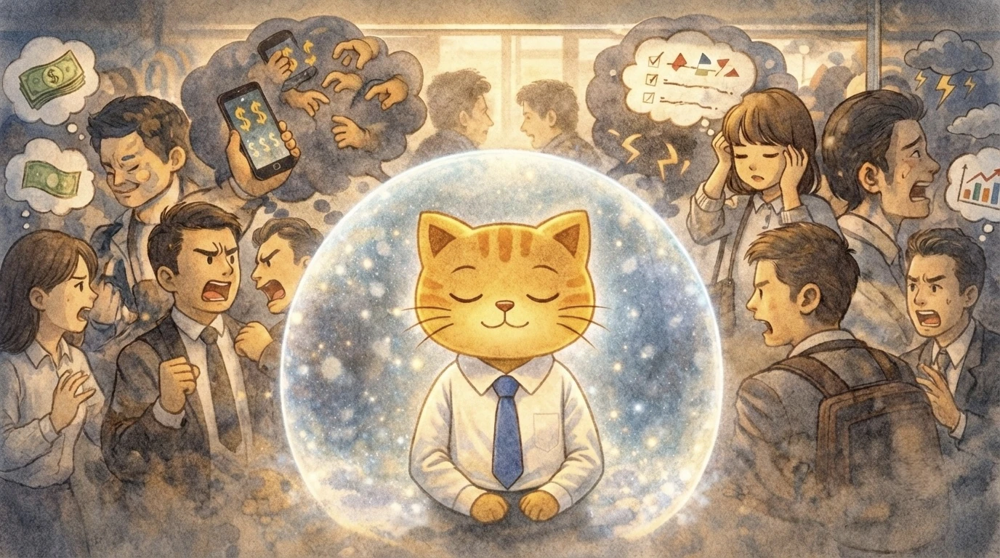

- 圖內疊字：空。
- 原圖與避讓：辦公室中小貓安坐於光罩；人物、思考框、光罩不擋。約 07:06 淡出，末張經典截圖另作參考。
- 下緣經文：《中阿含經・伽藍經》：若有所作，必不作惡……無濁歡悅……是謂得第四安隱住處。
- 上緣字幕（白字、靠左）：

- 06:00 或許有些讀者看到這裡會覺得：「斷除十結、不再輪迴，
- 06:04 聽起來實在太遙遠了。甚至，我連到底有沒有來世都不知道！」
- 06:12 其實，早在兩千多年前，佛陀對「伽藍人」開示時，
- 06:18 就給出了一個非常貼近人性的答案。佛陀說：我們不需要盲目迷信，
- 06:24 只要去親自驗證「什麼對自己當下有益」就可以了。
- 06:30 如果我們先放下對來世或升天的討論，
- 06:34 光是能在「此生此世」減少貪欲、瞋恚與愚癡，
- 06:38 我們就不會因為作惡而受苦，並且能與眾生無諍，內心充滿無濁的歡悅。
- 06:46 這份因為「不作惡、不貪、不瞋」而帶來的清明與自在，
- 06:52 就是我們在現代高壓生活中，隨時可以抵達的「心理舒適圈」（安隱處）。
- 06:56 解脫，從來不僅是死後的去向；
- 07:00 只要我們願意開始這場心靈的減法工程，當下，就是最美的彼岸。
