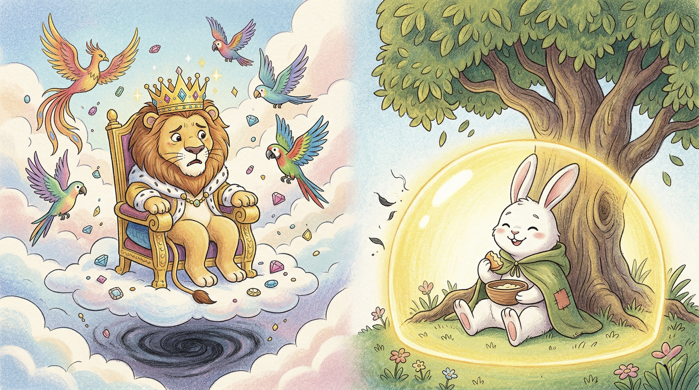
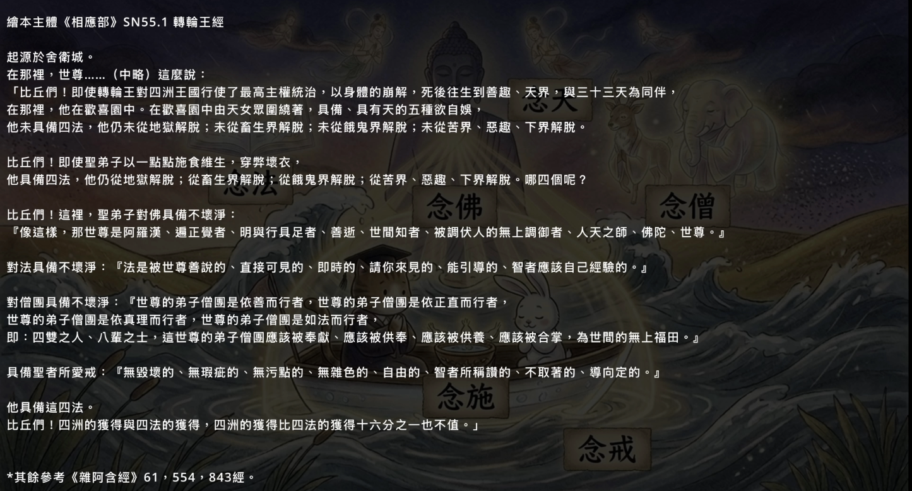

已對照作者提供的 640×360 影片、8 張原圖與 1 張片尾出處截圖。影片長 08:51.367。以下為 8 幕、93 筆字幕與同圖收尾。時間碼以約 2 秒取樣定位。片頭極短、沿用系列共用封面，供辨識。影片為書架第 07 本，ID 為 `jCXyluhcEb0`。

## 文字層與網頁定位

- `topSubtitle` 是上緣旁白字幕，影片為黑字靠左，網頁起排 x=1.5%、y=1%、最大寬 97%。加淺色襯底以維持亮暗背景對比。直式小螢幕若換行會碰到章名或原圖標示，將字幕放進圖片正上方的獨立區塊。
- `artOverlay` 是章名與收尾語。以**實際顯示的完整圖像**左上角作原點，X 對圖寬、Y 對圖高，表中的百分比是文字區中心，CSS 可使用 `left`、`top` 和 `translate(-50%, -50%)`。圖框隨圖像等比縮放，若有留白或按鍵，排除它們。白字單行，依表中的圖寬比例設字級與最大寬，字重約 600，亮區可加細陰影。直式沿用相同圖框百分比。一般章名從切入該幕持續至離開；收尾有獨立的兩行文字。
- `bakedText` 是已印進原圖的字。顯示完整畫幅，圖片可用等比 contain，讓原有標牌完整可見。
- `bottomScripture` 是下緣經文與來源。網頁放在圖框下方的可展開、可選取文字區，避免蓋到圖中標牌。按鍵沿用現有閱讀器設計並與文字分層。
- 幕名可入目錄。對應畫面未設疊字時，照空陣列渲染。章名、字幕和經文各自依時間更新。

| 幕 | 圖內白字 | X | Y | 最大寬 | 字級占圖寬 | 位置與避讓 |
| --- | --- | --- | --- | --- | --- | --- |
| S02 | 四入流分 | 43% | 19% | 28% | 6% | 上方林際與亮天空之間，位於左側善友木牌右上。 |
| S04 | 佛不壞淨 | 50% | 37% | 45% | 9% | 中央佛像胸口的放射光上。保留臉與下方小船。 |
| S05 | 法不壞淨 | 50% | 30% | 45% | 9% | 正中央，橫跨上方書本的下半和山線，位於小貓帽頂上方。 |
| S06 | 僧不壞淨 | 41% | 24% | 45% | 9% | 偏左上天空。右側鹿與象的位置留空。 |
| S07 | 聖戒成就 | 50% | 30% | 45% | 9% | 畫面中央，放在光罩上緣、角色頭頂以上。 |
| S08 | 六念 | 50% | 30% | 22% | 9% | 中央佛像胸前、念佛牌上方，右上念天牌仍可辨識。 |
| END | 從此以後，無論風雨，／這艘船將永不沉沒。 | 50% | 54% | 82% | 7.2% | 沿用六念圖，整圖先加約 65% 黑色遮罩，文字置於遮罩上，保留兩行。 |

S01、S03 的 `artOverlay` 是空陣列。收尾的「／」代表實際換行。

## 分鏡索引

| 幕 | 約略時間 | 主題 | 原圖 | 下緣來源 |
| --- | --- | --- | --- | --- |
| S01 | 00:00–01:11 | 隨法行與隨信行 | IMG_0393.jpeg | SA61 |
| S02 | 01:11–01:53 | 四入流分 | IMG_0395.jpeg | SA843 |
| S03 | 01:53–02:55 | 轉輪王與聖弟子 | IMG_0396.jpeg | SN55.1 |
| S04 | 02:55–04:11 | 佛不壞淨 | IMG_0397.jpeg | SN55.1 |
| S05 | 04:11–05:11 | 法不壞淨 | IMG_0399.jpeg | SN55.1 |
| S06 | 05:11–06:31 | 僧不壞淨 | IMG_0401.jpeg | SN55.1 |
| S07 | 06:31–07:39 | 聖戒成就 | IMG_0400.jpeg | SN55.1 |
| S08 | 07:39–08:45 | 六念 | IMG_0402.jpeg | SA554 |
| END | 08:45–08:51 | 收尾 | IMG_0402.jpeg | — |

## 逐幕圖文
### S01 隨法行與隨信行｜00:00–01:11

原圖 `assets/IMG_0393.jpeg`。

**圖內疊字**　空陣列。

**原圖內文字與避讓**　上左貓咪與「隨法行」、下左兔子與「隨信行」、中央「須陀洹」、右側「涅槃」及各牌英文，都是原圖自帶字。 保留合流線和四個標示，特別留出左下牌。

**下緣經文**

- 00:01 SA61｜若於此法增上智慧思惟、觀察、忍，是名隨法行。超昇離生、越凡夫地，未得須陀洹果，中間不死，必得須陀洹果。

**上緣字幕**

| 約略起點 | 字幕讀錄 |
| --- | --- |
| 00:01 | 在修行的這條小河畔，每個人的起點都不太一樣喔！ |
| 00:07 | 你看，這隻戴著學士帽、穿著學士袍的「隨法行」貓咪， |
| 00:11 | 他擁有著敏銳的智慧，凡事都喜歡拿著放大鏡專注地觀察、思惟， |
| 00:19 | 看清了書本中漂浮的邏輯，非得把生命的無常徹底想明白了， |
| 00:23 | 才肯邁出安心的下一步。 |
| 00:27 | 而另一邊，是這隻雙手合十、眼神澄澈的「隨信行」小兔， |
| 00:33 | 雖然他不像貓咪那樣理性思辨，但只要聽聞了清淨的佛法， |
| 00:39 | 心中就會自然生起無比純淨的信任與安定，身邊就自然盛開出了蓮花。 |
| 00:45 | 你看，當這兩股不同的力量在主流匯合，他們都已經超越了凡夫的境界！ |
| 00:53 | 不管是貓咪那種理性的觀察智慧，還是小兔那份感性的信任信心， |
| 00:59 | 只要目標一致，順著河流主流而下，他們都已經成為了「須陀洹」， |
| 01:05 | 中間永不死去，必定能走向彼岸那光芒溫暖的「涅槃」寂靜！ |

### S02 四入流分｜01:11–01:53

原圖 `assets/IMG_0395.jpeg`。

**圖內疊字**　`四入流分`，採用上表座標。

**原圖內文字與避讓**　四張木牌「親近善友」「聽聞正法」「內正思惟」「法次法向」已在畫中。 保留貓頭鷹、燈、指南針、船槳與四塊牌。

**下緣經文**

- 01:11 SA843｜流者謂八聖道。入流分有四種，謂親近善男子、聽正法、內正思惟、法次法向。入流者成就四法，謂於佛、法、僧不壞淨，聖戒成就。

**上緣字幕**

| 約略起點 | 字幕讀錄 |
| --- | --- |
| 01:11 | 那麼，我們該怎麼駕駛生命的小船， |
| 01:15 | 正式駛入這條名為「八正道」的清淨大河呢？ |
| 01:19 | 佛陀給了一份稱為「四入流分」的航行指南： |
| 01:23 | 首先，是找到能為你提燈引路的導航員「親近善知識」； |
| 01:29 | 接著，專心讀懂他給你的航海圖，也就是「聽聞正法」。 |
| 01:35 | 有了外部的指引後，我們必須轉向內心， |
| 01:39 | 用正確的邏輯去核對指南針，也就是「內正思惟」； |
| 01:43 | 最後，也是最重要的一步，就是親自握住船槳， |
| 01:49 | 在生活中確實地划動它，也就是「法次法向」。 |

### S03 轉輪王與聖弟子｜01:53–02:55

原圖 `assets/IMG_0396.jpeg`。

**圖內疊字**　空陣列。

**原圖內文字與避讓**　無。 左邊王座及下方漩渦、右邊兔子與金色光罩都要入畫。

**下緣經文**

- 01:53 SN55.1｜影片此幕下緣只顯示經名「相應部 SN 55.1 轉輪王經」。

**上緣字幕**

| 約略起點 | 字幕讀錄 |
| --- | --- |
| 01:53 | 想像一下，如果有人擁有全世界的財富與權力， |
| 01:59 | 甚至死後還能升上天堂，享受無盡的派對。 |
| 02:03 | 這樣的人，是不是最安全的呢？佛陀搖搖頭說：「不是的。」 |
| 02:09 | 就像左邊這位擁有統治權的轉輪聖王， |
| 02:13 | 即使他擁有一切，但因為心裡沒有真正的依靠，他的王座底下， |
| 02:19 | 依然藏著通往痛苦深淵「地獄界、畜生界、餓鬼界」的陷阱。 |
| 02:25 | 但你看看右邊這位聖弟子，他或許只能吃著簡單的粗茶淡飯， |
| 02:31 | 披著縫補過的舊斗篷；但他的內心，卻擁有了四把無堅不摧的保護傘！ |
| 02:39 | 這四股力量化為金色的防護罩， |
| 02:43 | 讓他徹底斬斷了掉入痛苦深淵的可能，獲得了真正的自由。 |
| 02:49 | 究竟是哪四股神奇的力量，竟然比全世界的財富與權力還要強大呢？ |

### S04 佛不壞淨｜02:55–04:11

原圖 `assets/IMG_0397.jpeg`。

**圖內疊字**　`佛不壞淨`，採用上表座標。

**原圖內文字與避讓**　無。 白字疊在佛光上時加細暗描邊或陰影。

**下緣經文**

- 02:55 SN55.1｜影片畫面依序列如來、應、等正覺、明行足、善逝、世間解、無上士、調御丈夫、天人師、佛世尊。

**上緣字幕**

| 約略起點 | 字幕讀錄 |
| --- | --- |
| 02:55 | 這第一股讓內心強大、永不動搖的力量，就是對佛陀深深信任的「佛不壞淨」。 |
| 03:03 | 佛陀究竟是誰？祂不只是供桌上的神像，而是一位最完美的生命導師： |
| 03:09 | 祂像一位「阿羅漢」，已經斷開了所有痛苦的鎖鏈，值得我們最誠心的致敬； |
| 03:17 | 祂是一位「等正覺者」，靠自己的智慧，徹底看清了宇宙運行的真相。 |
| 03:23 | 祂說到做到，智慧與行為完美合一，是「明行足」； |
| 03:29 | 祂走在最安穩的解脫之路上，永不退轉，是「善逝」。 |
| 03:35 | 祂完全了解我們身處的這份複雜世界，是「世間解」； |
| 03:39 | 對於難以調教的人心，祂是最有耐心的導師，這就是「無上士、調御丈夫」。 |
| 03:47 | 不管是天上的神靈還是人間的我們，祂都是指引方向的「天人師」。 |
| 03:53 | 祂是徹底醒覺的「佛陀」，也是這世間最珍貴、最值得尊崇的長者「世尊」。 |
| 04:01 | 當我們心裡裝著佛陀的這十種光芒， |
| 04:03 | 就像在黑暗的海上看到了永不熄滅的燈塔，小船再也不會因為恐懼而搖晃了。 |

### S05 法不壞淨｜04:11–05:11

原圖 `assets/IMG_0399.jpeg`。

**圖內疊字**　`法不壞淨`，採用上表座標。

**原圖內文字與避讓**　無。 保留書本輪廓、小貓望遠鏡和兔子手中的水。

**下緣經文**

- 04:11 SN55.1｜法是被世尊善說的、直接可見的、即時的、請你來見的、能引導的、智者應該自己經驗的。

**上緣字幕**

| 約略起點 | 字幕讀錄 |
| --- | --- |
| 04:11 | 這第二股不再動搖的力量，是對真理正法的絕對信心「法不壞淨」。 |
| 04:17 | 佛法不是什麼神祕的咒語，而是一張無比清晰的導航地圖。 |
| 04:23 | 這份真理是「善說的」，佛陀把路線畫得明明白白，沒有一點隱瞞。 |
| 04:29 | 它不需要等到下輩子才兌現，它是「即時的、非時的」； |
| 04:35 | 只要你當下照著做，立刻就能感受到「直接可見」的改變， |
| 04:39 | 佛陀從不強迫我們盲目相信，這條河永遠敞開著大門， |
| 04:45 | 向世界發出邀請：「請你自己來看看吧！」。 |
| 04:49 | 這股真理的水流是「能引導的」， |
| 04:53 | 它會穩穩地推著小船，朝著沒有痛苦的彼岸前進。 |
| 04:57 | 不過，別人說水有多甜都沒用；真理的清涼，必須像喝水一樣， |
| 05:05 | 當你親自喝下了這口清涼的水，你對這條航線，就再也不會有任何懷疑了。 |

### S06 僧不壞淨｜05:11–06:31

原圖 `assets/IMG_0401.jpeg`。

**圖內疊字**　`僧不壞淨`，採用上表座標。

**原圖內文字與避讓**　無。 保留鹿、象、田地及船上合掌的角色。

**下緣經文**

- 05:11 SN55.1｜影片下緣先列善向、正向、直向、等向，接四向四果、四雙八士。
- 05:51 SN55.1｜影片下緣改列戒、定、慧、解脫、解脫知見，以及供養、恭敬、尊重與無上福田。

**上緣字幕**

| 約略起點 | 字幕讀錄 |
| --- | --- |
| 05:11 | 這第三股讓我們無比安心的力量，是對僧團的深深敬意與信任的「僧不壞淨」。 |
| 05:19 | 不過，這裡說的僧團，指的不是普通的旅人， |
| 05:23 | 而是那些已經成功走在解脫道上的前輩們。 |
| 05:27 | 他們聽從了佛陀的導航，不偏不倚、誠實且正直地航行， |
| 05:33 | 是「善向、正向、直向、等向」的實踐者。 |
| 05:39 | 這群學長姐中，有的剛進入聖流，有的已經完全覺悟， |
| 05:45 | 總共有四個階段、八種層次的境界，他們就是「四雙八輩」聖弟子！ |
| 05:51 | 他們的小船裝滿了「戒律、禪定與智慧」， |
| 05:55 | 早就掙脫了煩惱的麻繩，獲得了真正的自由與清晰的視野。 |
| 06:01 | 看著他們安穩前進的背影，我們心裡會生起莫大的勇氣： |
| 06:07 | 「原來這條航線是真的，原來抵達彼岸是做得到的！」 |
| 06:11 | 當我們帶著恭敬的心，向這群充滿智慧的聖者合掌致敬、學習與分享時， |
| 06:19 | 就像是把最珍貴的善意種子，輕輕播種在世界上最肥沃的土壤裡。 |
| 06:25 | 他們，正是這世間能讓善意結出最豐碩果實的「無上福田」。 |

### S07 聖戒成就｜06:31–07:39

原圖 `assets/IMG_0400.jpeg`。

**圖內疊字**　`聖戒成就`，採用上表座標。

**原圖內文字與避讓**　無。 保留罩頂、船身與兩名角色。

**下緣經文**

- 06:31 SN55.1｜具備聖者所愛戒。無毀壞、無瑕疵、無污點、無雜色、自由、智者所稱讚、不取著、導向定。

**上緣字幕**

| 約略起點 | 字幕讀錄 |
| --- | --- |
| 06:31 | 最後，這股讓內心徹底安定的力量，是我們親自守護的「聖戒成就」。 |
| 06:37 | 戒律，並不是限制自由的鎖鏈，而是這艘船最堅固、最可靠的船身。 |
| 06:43 | 這艘船的木材是「無毀壞、無瑕疵」的，沒有任何裂縫， |
| 06:49 | 所以煩惱的苦水永遠無法滲透進來； |
| 06:53 | 它是「無污點、無雜色」的，讓我們能挺起胸膛，活得光明磊落。 |
| 07:01 | 佛陀說，這是一種「自由」的戒， |
| 07:03 | 因為我們不再被壞習慣拉扯，也不再被罪惡感束縛。 |
| 07:09 | 這份自律與清淨，連最有智慧的人都會為你拍手稱讚。 |
| 07:15 | 我們持守它，並不是為了交換什麼獎勵， |
| 07:19 | 而是因為唯有這份不心虛的平靜，能讓心像平靜的湖面一樣， |
| 07:23 | 導向「定境」的深處。 |
| 07:25 | 當這四股力量，佛、法、僧、戒，在我們心裡匯聚成這座金色的防護罩時， |
| 07:33 | 不論外面的風浪再大，這艘小船都已經獲得了永遠的平安。 |

### S08 六念｜07:39–08:45

原圖 `assets/IMG_0402.jpeg`。

**圖內疊字**　`六念`，採用上表座標。

**原圖內文字與避讓**　「念法」左上、「念天」右上偏中、「念佛」中央、「念僧」右側、「念施」船身、「念戒」右下。 下緣經文移到圖外，避免壓住「念戒」。注意六念的原圖是 IMG_0402.jpeg。

**下緣經文**

- 07:39 SA554｜世尊說依四不壞淨，增六念處。我悉成就，我當修習念佛功德、念法、念僧、念戒、念施、念天。

**上緣字幕**

| 約略起點 | 字幕讀錄 |
| --- | --- |
| 07:39 | 擁有「四不壞淨」就像獲得了生命中最強大的保險。 |
| 07:45 | 但如果你正面臨病痛、恐懼或不安的風浪時，該怎麼辦呢？ |
| 07:49 | 在雜阿含經554經中，長者摩訶男在病痛中，學會了「六念」這門修法。 |
| 07:57 | 這就像是把心轉向四種已經擁有的寶藏：念佛、念法、念僧、念戒。 |
| 08:05 | 每念一次，就像是在黑暗中點亮一盞燈， |
| 08:09 | 讓散亂的心重新校準，回到這四種清淨的力量上。 |
| 08:15 | 除此之外，還要加上兩份溫暖的練習： |
| 08:19 | 「念布施」：回憶自己曾經分享、給予的快樂，讓心變得開闊且富有； |
| 08:25 | 「念天」：思惟那些因善行而發光的高尚生命，提醒自己也擁有同樣的潛質。 |
| 08:33 | 透過這六種思惟，你的心會超越身體的痛苦。這就是依四不壞淨，增六念處。 |
| 08:41 | 讓原本堅固的信心，化為當下每一口呼吸的平靜。 |

### END 收尾｜08:45–08:51

沿用 `assets/IMG_0402.jpeg`。由六念畫面切換為全圖壓暗（黑色遮罩約 65%），中央顯示兩行收尾。此版只顯示收尾白字。

## 經典出處與文字核對

- 片尾主體出處為《相應部》SN55.1〈轉輪王經〉，片尾另列《雜阿含經》61、554、843 經。S01 對應 SA61，S02 對應 SA843，S03–S07 對應 SN55.1，S08 對應 SA554。
- 影片下緣有縮寫和轉述，按畫面記錄。尤其 S06 約 05:51 的下緣換段沿用影片所標的 SN55.1；若要對外作逐字引文，先與原典逐段校對。長篇 SN55.1 文字以所附片尾截圖供對照。
- S01 的「中間永不死去」保留為影片字幕記錄。導讀釋義沿同幕下緣的次序表達「尚未得須陀洹果，命終前必得須陀洹果」，避免讀成證果後不會死亡。
- S02 圖牌寫「親近善友」，字幕寫「親近善知識」，影片下緣經文寫「親近善男子」。三處照各自來源保留。S08 圖牌寫「念施」，旁白說「念布施」。

## Codex 實作交接

從最新 `main` 建立實作分支，先按專案的 `AGENTS.md`、`docs/PROJECT.md`、`docs/HANDOFF.md`、`docs/SOURCES.md` 與現有閱讀器實作書架第 07 本的導讀與繪本。沿用現有手機、iPad 橫直式的閱讀器按鍵與導覽。核對翻頁、目錄、頁碼、經文展開、返回導讀、畫面旋轉以及所有章名和木牌的可讀性。以 `storyboard.json` 取圖與文字，`assets-manifest.json` 查核路徑和檔案；`reference/` 提供影片疊字定位與經文截圖。提供可點開的試閱方式與實作分支或 PR。
