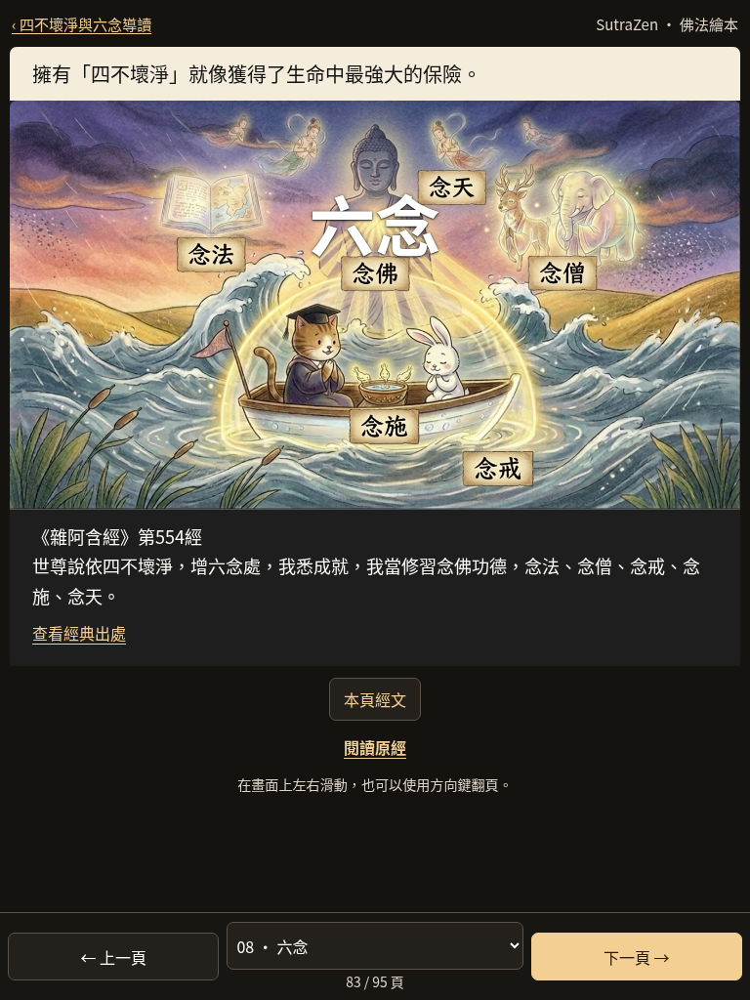

# 《四不壞淨與六念》試閱與核對

[實作PR #19](https://github.com/rooneyflower-star/sutrazen-map/pull/19)，分支：`feat/four-purities-six-recollections`。作者已授權本次直接發布；是否上線，以PR實際合併SHA及Pages成功為準。

- 導讀入口：`four-purities-six-recollections/`
- 閱讀器：`four-purities-six-recollections/book/`
- 8幕／93筆原字幕＋同圖收尾＋製作說明，共95頁；末頁可回到第一頁。
- [逐幕位置與原典核對表](../../four-purities-six-recollections/layout-audit.md)
- [測試結果](validation.json)

| 幕／起始頁 | iPad橫式 | iPad直式 |
| --- | --- | --- |
| 01 隨法行與隨信行／1 | [畫面](S01-1024x768.webp) | [畫面](S01-768x1024.webp) |
| 02 四入流分／13 | [畫面](S02-1024x768.webp) | [畫面](S02-768x1024.webp) |
| 03 轉輪王與聖弟子／22 | [畫面](S03-1024x768.webp) | [畫面](S03-768x1024.webp) |
| 04 佛不壞淨／33 | [畫面](S04-1024x768.webp) | [畫面](S04-768x1024.webp) |
| 05 法不壞淨／45 | [畫面](S05-1024x768.webp) | [畫面](S05-768x1024.webp) |
| 06 僧不壞淨／56 | [畫面](S06-1024x768.webp) | [畫面](S06-768x1024.webp) |
| 07 聖戒成就／70 | [畫面](S07-1024x768.webp) | [畫面](S07-768x1024.webp) |
| 08 六念／83 | [畫面](S08-1024x768.webp) | [畫面](S08-768x1024.webp) |
| 收尾／94 | [畫面](END-1024x768.webp) | [畫面](END-768x1024.webp) |
| 製作說明／95 | [畫面](afterword-1024x768.webp) | [畫面](afterword-768x1024.webp) |

[導讀畫面](guide-768x1024.webp)




## 發布前的本機試閱

[下載本分支完整ZIP](https://github.com/rooneyflower-star/sutrazen-map/archive/refs/heads/feat/four-purities-six-recollections.zip)，解壓後在含`index.html`的根目錄執行：

```sh
python3 -m http.server 8765 --bind 0.0.0.0
```

Windows可用`py -m http.server 8765 --bind 0.0.0.0`。電腦開啟`http://127.0.0.1:8765/four-purities-six-recollections/`。iPad與電腦同Wi-Fi，將網址中的`127.0.0.1`換成電腦區域網路IP即可試閱。正式上線及固定版本ZIP以交付訊息連結為準。

## 重現驗證

```sh
python scripts/build-four-purities-six-recollections.py --check
python scripts/check-four-purities-six-recollections.py --verify-sources --screenshots
```

需要Python Playwright、Pillow、lxml及Chromium。四尺寸共380次頁面狀態、完整章名座標、來源切換、目錄、快速翻頁、經文展開／捲動、閱讀位置、旋轉、重讀與舊六本入口通過。首頁CDN以系統CA驗證的HTTP用戶端讀取公開原回應，再交給Chromium，未停用TLS驗證。

尚待實體Safari及外部YouTube播放驗收。素材／原字幕與影片、原典的兩處差異及暫行處理，已在核對表明列，不假稱已與影片所有圖面逐像素相同。
