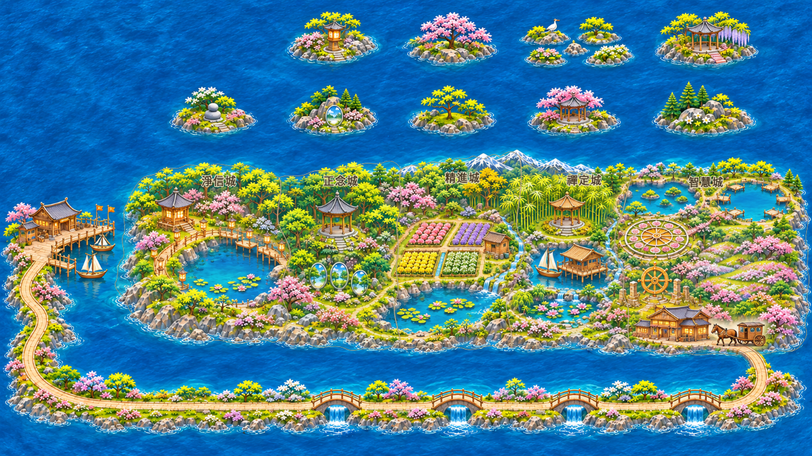

# 五大城分區：實作截圖與驗證

基準`a238a0fb549966ac0510b5b89f18b913c8ec40b6`，分支`feat/worldmap-five-cities`。本機試版，尚未合併或公開部署；正式/game/尚未包含這一輪分區。

作者已確認西到東**淨信城 → 正念城 → 精進城 → 禪定城 → 智慧城**，維持原地景及上方五根五力的縱向對應。區域淡底為6%透明度，米金／青綠／暖杏／淡藍／淡紫；城名使用網頁文字。

## 分區圖層總覽

以下直接呈現同一原插畫與新HTML／SVG實作圖層，方便審閱海岸與內界；沒有加遊戲地標、霧、角色或dock，**不是玩家完整畫面**。底圖未重繪、未生成新細節。

[有6%淡底](regions-tinted.png) · [無淡底比較](regions-untinted.png)

## 實際遊戲畫面

以下全部為真正遊戲runtime中的截圖。採隔離的全十四本已讀測試fixture以看清地形與可點地標，不代表作者存檔，也不聲稱測試人員本輪讀完十四本。新玩家0本的薄霧與鎖定另有操作驗證。

| 情境 | 截圖 |
| --- | --- |
| 原生縮小至下限後，五城全名同時可見 | [1600×1000](game-five-cities-wide.png) |
| 手機直式，可拖曳探索 | [360×800](game-360x800.png) |
| 手機橫式 | [844×390](game-844x390.png) |
| 平板直式 | [768×1024](game-768x1024.png) |
| 平板橫式 | [1024×768](game-1024x768.png) |
| 桌面，原生放大後的探索狀態 | [1280×900](game-1280x900.png) |

總覽截圖是按既有「−」縮小到coverScale下限，再用原生拖曳完成；沒有增加全景按鈕，也未透過測試API改鏡頭。詳[截圖紀錄](wide-capture.json)。窄窗或放大時只顯示當前視野，其他城仍可拖曳抵達。

## 實測結果

[獨立操作報告](validation.json)：**PASS，JavaScript／同源HTTP錯誤0**。

- 五類尺寸皆執行原生觸控拖曳與縮放；新線圖、背景、原地形回饋、霧及互通線共用世界矩陣。既有地標錨點沒有漂移。
- 五城各選一個既有地標實際點擊，城市文字／SVG層沒有攔截；原港口dialog也能正常開啟。
- 原生繪本第5頁接續、返回既有複習書架、切換地圖／城池／書架再回地圖成功。測試用已讀14本及書籤index4保持；未以這輪圖層操作新增完成或改資格。
- 0本fixture仍有霧，五陰顯示鎖定且沒有讀本動作；五城不是新增關卡或新的解鎖來源。
- 地名標牌開關同時控制五城名稱，原46條互通連線開關仍可使用；未新增資料／保存鍵值。
- [分區幾何](geometry.json)：5個閉合區、4條共享內界；輪廓內3,888個取樣沒有空隙／重疊／越出所定輪廓，16個主陸地地標歸屬原family，排除港口／北島／半島。獨立QA另取樣2,100點（輪廓內1,568點均恰屬一城）。這是手工描線的幾何核對，非自動辨識真實海岸。
- [來源保護](source-guard.json)：原畫、首頁、十四本原口白／經文／插畫與讀本、地標與關係資料、相機、閱讀資格與保存程式逐位元保留。JS語法、遊戲產生器及SEO15／Google檢查通過；Pages main:/不變。

實機iPhone／iPad Safari未測，以上手機／平板是Chromium尺寸與觸控模擬。沒有重跑未改動的1,192步全書；本輪聚焦新增分區的實際風險。

本機啟動與實作配置見[五城試版說明](../../play/worldmap-five-cities/README.md)。
