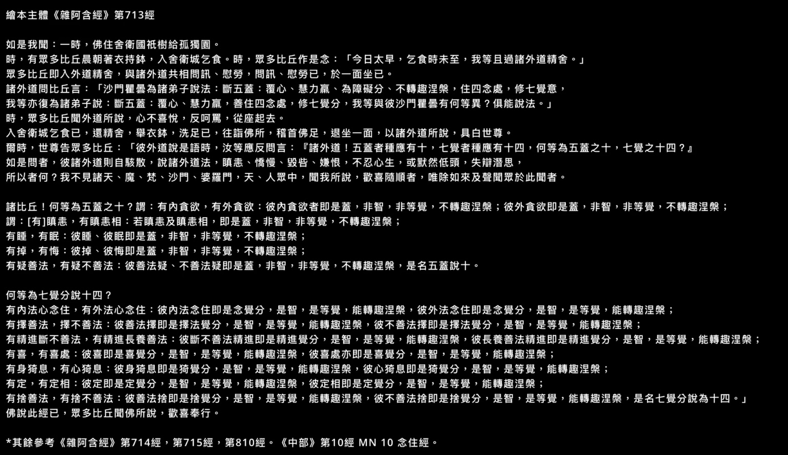

# 七覺支

依《七覺支》影片上緣字幕逐句轉錄口白，下緣引文按畫面換文時間列出。時間取每秒抽樣，轉場及字幕起點約有一秒誤差。片長 3:33.21。各段延續至下一時間碼。

網頁疊字座標 (x,y) 是字框中心相對於完整原圖左上角的百分比。保留全圖比例；覺支名用黑色粗體，字高約圖高 13%，五蓋與火候標籤約 9%。口白與引文在網頁圖外對讀；影片上緣字幕、下緣經文各自獨立。原圖已有的角色標籤保留一次。第五覺支依影片用「輕安」，引經保留「猗息」「猗覺分」。

## 01　浮動｜0:00–0:15

**網頁疊字**　無

**口白（依影片字幕）**

0:00 想要專心修行的小貓，想讓自己的心安靜下來。

0:05 可是，明明身體坐著不動，心卻一下想東、一下想西。

0:11 為什麼越想安靜，心反而越靜不下來呢？

**影片下緣經文**

本幕無引文。

## 02　昏沉｜0:15–0:28

**網頁疊字**　無

**口白（依影片字幕）**

0:15 可是，有時候又剛好相反。才靜坐一下子，小貓就昏昏欲睡，提不起精神。

0:24 原來，心有時太浮動，有時又太沉滯。

**影片下緣經文**

本幕無引文。

## 03　五蓋｜0:28–0:43

**網頁疊字**　貪欲 (18,70)、瞋恚 (33,57)、惛沉 (50,44)、掉悔 (67,57)、疑 (84,70)。黑色粗體，各對應一個角色。

**口白（依影片字幕）**

0:28 在修行的路上，心常常會被各種障礙打擾。佛法把這些障礙，叫做「五蓋」。

0:36 不過，小貓眼前最常遇到的，還是兩種狀況：心太浮動，和心太沉滯。

**影片下緣經文**

0:28｜雜阿含713｜是名五蓋說十。

## 04　念｜0:43–1:05

**網頁疊字**　念 (64,53)

**口白（依影片字幕）**

0:43 佛陀教導七種幫助我們走向覺悟的修習，稱為「七覺支」。

0:49 第一個，是「念覺支」。

0:52 依四念處，清楚覺察身體、感受、心念，以及所經驗的種種現象。

0:59 就像小貓覺察自己的呼吸，也看見念頭如落葉般飄過，不必跟著它走。

**影片下緣經文**

0:43｜雜阿含713｜是名七覺分說為十四。

0:49｜雜阿含715｜何等為念覺分食？謂四念處思惟已

0:59｜雜阿含713｜有內法心念住、有外法心念住；彼內法念住即是念覺分，是智是等覺，能轉趣涅槃；彼外法念住即是念覺分，是智是等覺，能轉趣涅槃。

## 05　擇法｜1:05–1:19

**網頁疊字**　擇法 (70,53)

**口白（依影片字幕）**

1:05 第二個，是「擇法覺支」。

1:09 學會分辨善法與不善法，知道什麼值得培養，什麼應該遠離。

1:15 就像照顧花園，要認得幼苗，也要認得雜草。

**影片下緣經文**

1:05｜雜阿含713｜有擇善法、擇不善法。彼善法擇，即是擇法覺分，是智是等覺，能轉趣涅槃。彼不善法擇，即是擇法覺分，是智是等覺，能轉趣涅槃。

## 06　精進｜1:19–1:33

**網頁疊字**　精進 (70,53)

**口白（依影片字幕）**

1:19 第三個，是「精進覺支」。分辨清楚後，還要付諸行動。

1:26 就像四正勤所教導的：避免、斷除不善法，讓善法生起，並持續增長。

**影片下緣經文**

1:19｜雜阿含713｜有精進斷不善法，有精進長養善法。彼斷不善法精進，即是精進覺分，是智是等覺，能轉趣涅槃。彼長養善法精進，即是精進覺分，是智是等覺，能轉趣涅槃。

1:26｜雜阿含715｜何等為精進覺分食？彼四正斷思惟，

## 07　喜｜1:33–1:45

**網頁疊字**　喜 (49,53)

**口白（依影片字幕）**

1:33 第四個，是「喜覺支」。當善法逐漸增長，心也生起清明的歡喜。

1:41 這份喜悅，來自修行，而不只是外在的享樂。

**影片下緣經文**

1:33｜雜阿含713｜有喜，有喜處。彼喜即是喜覺分，是智是等覺，能轉趣涅槃。彼喜處，亦即是喜覺分，是智是等覺，能轉趣涅槃。

## 08　輕安｜1:45–1:58

**網頁疊字**　輕安 (56,19)，位於臉部右上方天空。

**口白（依影片字幕）**

1:45 第五個，是「輕安覺支」。歡喜之後，身與心漸漸平息，變得柔和、安穩。

1:54 這不是昏沉，而是清醒而舒適的寧靜。

**影片下緣經文**

1:45｜雜阿含713｜有身猗息，有心猗息。彼身猗息，即是猗覺分，是智是等覺，能轉趣涅槃。彼心猗息，即是猗覺分，是智是等覺，能轉趣涅槃。

## 09　定｜1:58–2:10

**網頁疊字**　定 (69,53)

**口白（依影片字幕）**

1:58 第六個，是「定覺支」。身心安穩後，心逐漸集中，不再四處散亂。

2:06 就像湖水平靜下來，心能穩穩地安住。

**影片下緣經文**

1:58｜雜阿含713｜有定，有定相。彼定即是定覺分，是智是等覺，能轉趣涅槃。彼定相即是定覺分，是智是等覺，能轉趣涅槃。

## 10　捨｜2:10–2:22

**網頁疊字**　捨 (62,28)

**口白（依影片字幕）**

2:10 第七個，是「捨覺支」。隨著定力成熟，貪著與憂惱逐漸止息。

2:17 心保持平等安穩，不再被喜歡與討厭牽著走。

**影片下緣經文**

2:10｜雜阿含810｜貪憂則滅，得平等捨

2:17｜雜阿含713｜有捨善法，有捨不善法。彼善法捨，即是捨覺分，是智是等覺，能轉趣涅槃。彼不善法捨，即是捨覺分，是智是等覺，能轉趣涅槃。

## 11　看火候，調整用功｜2:22–2:59

**網頁疊字**　昏沉 (27,57)、浮動 (87,57)。中央念燈及兩側六個角色的名稱已在原圖內。

**口白（依影片字幕）**

2:22 修心，不是每次都用同一種方法。

2:26 就像照顧火一樣，火太小，要幫它升起來；火太大，要讓它安穩下來。

2:33 火候剛剛好時，就要好好守護。

2:37 當心太沉、提不起精神時，可以多修擇法、精進、喜，讓心重新明亮起來。

2:45 當心太躁、停不下來時，就多修輕安、定、捨，讓心慢慢安穩下來。

2:53 而念覺支，始終幫助我們看清，現在的心，到底需要什麼。

**影片下緣經文**

2:22｜雜阿含714｜若微劣心生、微劣猶豫，是時應修擇法覺分、精進覺分、喜覺分。所以者何？微劣心生、微劣猶豫，以此諸法示、教、照、喜。譬如小火，欲令其燃，足其乾薪。

2:45｜雜阿含714｜若掉心生、掉心猶豫，修猗覺分、定覺分、捨覺分。所以者何？掉心生、掉心猶豫，此等諸法能令內住一心攝持。譬如燃火，欲令其滅，足其燋炭，彼火則滅。

2:53｜雜阿含714｜念覺分者，一切兼助。

## 12　七覺支總結｜2:59–3:33.21

**網頁疊字**　無。原圖已有中央「念」，以及擇法、精進、喜、輕安、定、捨六個標籤。

**口白（依影片字幕）**

2:59 所以，修習七覺支，不只是把七個名字記起來。

3:04 更要時時觀察，現在，哪些覺支已經生起？哪些還沒有？

3:11 還沒生起的，如何培養？已經生起的，又如何修習，直到圓滿？

3:18 原來，修行不是勉強把心壓得平靜，

3:21 而是先清楚看見自己的心，再依當下的需要，善巧地修習。

3:27 讓七覺支漸漸成熟，走向覺悟與解脫。

**影片下緣經文**

2:59｜中部10《念住經》｜有念覺支時，了知有念覺支；沒有時，了知沒有。了知未生起的覺支如何生起，以及已生起的覺支如何修習圓滿。

## 片源與經典出處

[《七覺支》原影片](https://chatgpt.com/library?file_id=libfile_e9c8a6bd117081919adafdf2e06c58b4&account_id=personal)

繪本主體取自《雜阿含經》第713經。下圖保留作者提供的完整經文截圖；第714、715、810經及《中部》第10經的影片引文列在各幕。

